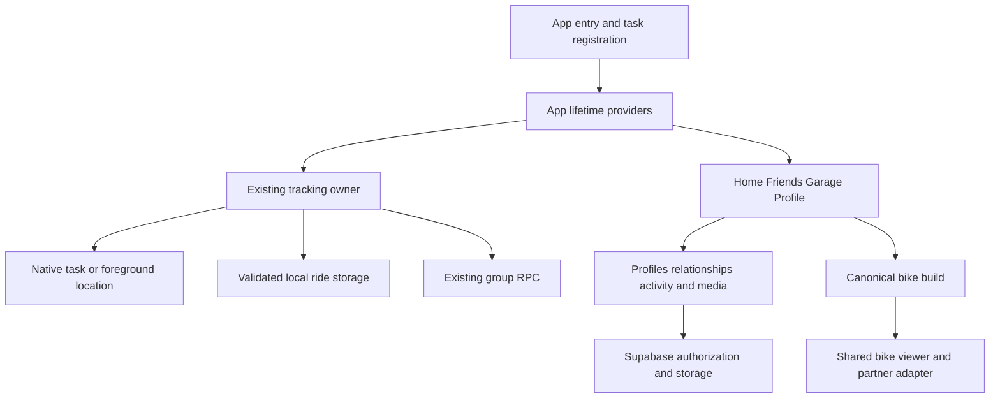

## Implementation progress, 2026-11-14

The requested four-tab routed implementation now exists on feature/home-friends-garage-profile, built from master. It includes persistent local builds, local Profile history/statistics, the connected social RPC/feed/relationships, privacy-filtered ride publication, and opt-in friend markers. See ../VERIFICATION.md for checks performed, chosen initial policies, and remaining native/product milestones. The original planning review follows unchanged.

# RepRide major update architecture and roadmap

Prepared 2026-11-14. Proposed implementation plan for review.

## Product direction

RepRide becomes a social riding platform for e-bike and e-moto riders, organized around riding, community, and bike customization. The four main destinations are Home, Friends, Garage, and Profile. Home opens on the riding map. A rider can start a solo recording, create or join a group, find sharing friends, and return to an ongoing ride from any tab.

This document records the requested scope, source review, proposed architecture, reuse opportunities, development order, and acceptance criteria. Architectural recommendations and unresolved product choices remain proposals.

## 1. Reviewed baseline

The implementation baseline is [CyrusVibeCoding/E-MotoApp](https://github.com/CyrusVibeCoding/E-MotoApp), branch `master`, commit `364cf6fc6f6c109aabb9faa4b43bbbdb4349d160`. The review checkout is `C:/Users/cyrus/AppData/Roaming/suitable/workspace/E-MotoApp`.

The earlier prototype at `C:/Users/cyrus/Documents/Codex/2026-11-12/new-x20/repride` contains Today, Friends, Garage, and Ranks with illustrative data. The supplied repository has Map, Rides, and Garage, durable recording, and group sharing. Use the supplied repository as the implementation baseline and the earlier prototype as visual and product reference.

| Area | Observed implementation | Reuse and extension |
| --- | --- | --- |
| App shell | `App.tsx` conditionally renders three tabs and a selected ride. Recorder and group hooks mount above those screens. | Extract screens and shared controls, then introduce four routed destinations. |
| Location ownership | `src/tracking.ts` serializes commands, storage mutations, GPS ingestion, group synchronization, and native tracking reconciliation. | Retain one owner for location and ride lifecycle. New screens consume its state and commands. |
| Background task | `index.ts` imports tracking before app registration. Tracking registers a module-scope TaskManager task and uses a foreground fallback. | Preserve task registration order, task name, permission fallback, and independent recording/sharing demand. |
| Recording math | `src/ride.ts` and `src/trackingCore.ts` filter fixes, reject jumps and duplicates, split gaps, and process delayed batches. | Retain calculations and metre-based storage. Add explicitly defined speed and moving-time measurements. |
| Persistence | `src/storageCore.ts` validates version-1 data under `@emoto/v1`. `@emoto/tracking-v1` separately stores tracking and group state. | Add a tested, recoverable migration for both records. Preserve saved rides, active drafts, bike details, consent, and pending Leave. |
| Native map | `src/RouteMap.tsx` uses `react-native-maps`, segmented routes, group markers, initial fitting, and recentering. Web has an explicit layout fallback. | Reuse camera and marker behavior behind a map component boundary. Evaluate provider migration independently. |
| Group rides | `src/groupApi.ts`, `src/groupModel.ts`, `src/useGroupRide.ts`, `src/GroupPanel.tsx`, and `backend/group.sql` implement anonymous identities, create/join/sync/leave, consent, expiry, and location exchange. | Preserve the RPC contract while adding durable rider profiles and a separate friend-location audience. |
| Bike | A single local make/model/nickname record persists. | Extend into an owned bike and versioned build configuration. |
| Community | Persistent profiles, friendship/follow graphs, feeds, posts, media, and achievements need implementation in this repository. | Use the earlier feed/mod UI as reference. Build actual data and authorization underneath the new screens. |

Source references are [app entry](../index.ts), [app shell](../App.tsx), [tracking owner](../src/tracking.ts), [recording logic](../src/ride.ts), [batch reducer](../src/trackingCore.ts), [storage validation](../src/storageCore.ts), [map](../src/RouteMap.tsx), and [group SQL](../backend/group.sql).

### Current behavior to carry forward

- Solo recording and group sharing are independent. Finish saves the personal ride while group sharing continues. Leave stops group sharing while an active personal recording continues.
- Group creation/joining requires consent. A group currently admits up to 20 members, uses an eight-character code, expires after 12 hours, and gives memberships a 90-second heartbeat lease. Foreground synchronization aims for five-second intervals. Freshness labels use a 20-second threshold. These are current implementation constants.
- The background path is implemented. Delivery, battery impact, OS termination behavior, and two-phone reliability still require physical-device verification.
- Restoring durable tracking state can resume a previously authorized, still-valid group. Older foreground-only documentation describes an earlier lifecycle.
- The map and local recorder work independently of backend configuration. Local rides and bike details survive reloads.

### Gaps and migration risks

- Repository instructions require Expo Router, while the current app uses custom tab state and has no `expo-router` dependency. Router installation and entry-point migration are explicit tasks.
- `PRODUCT.md`, portions of `README.md`, `GROUP-RIDES.md`, and `VERIFICATION.md` retain foreground-only descriptions. `BACKGROUND-BUILD.md`, newer handoff notes, and source provide later behavior. Reconcile these during implementation documentation work.
- The earlier preview's route-redaction helper and sharing settings are absent from this repository. Port and adapt that work before enabling shared routes. Existing segmented recordings need gap-aware redaction.
- Existing rides contain distance, timestamps, and route points. They lack dedicated moving-time, average/top-speed, wheelie, achievement, and publication records. Older rides need nullable unavailable measurements.
- `tracking.ts` awaits network work inside its serialized queue. Slow calls can delay controls and local checkpoints. Measure command latency and isolate synchronization in a separately tested hardening change before expanding location audiences.
- Recorder refreshes run every second and group refreshes every five seconds. New feeds and 3D viewers need selective subscriptions to avoid GPS/timer-driven full-screen rerenders.
- The durable tracking record includes the last fix and full group snapshot. Review cached-coordinate retention and invalidation when adding friend presence, expiry, blocking, and account switching.
- Current tests exercise pure logic, storage, SQL, and basic web navigation. Root-hook lifetime, task execution, and real-device navigation during recording need additional regression coverage.

## 2. Navigation and screen ownership

| Destination | Primary experience | Supporting screens |
| --- | --- | --- |
| Home | Interactive map, sharing friends, separate group participants, solo recording, create/join group, current ride panel | Active ride details, group panel, create/join forms, friend marker preview |
| Friends | Chronological activity from friends and followed riders, recent rides, text/media posts, rider-profile entry points | Compact search/add-friend action, requests, follow controls, post composer and details |
| Garage | Owner's bike, rotate/zoom/inspect viewer, supported visual customization, installed mods and accessories | Bike details, mod editor, supported-part selector, build save status |
| Profile | Avatar, username, total distance, longest measured wheelie, achievements, featured build, mods, recent rides and posts | Ride history/detail, settings, sharing controls, leaderboard entry |

Use one profile screen for self and other riders. Ownership determines edit actions. Authorization determines visible statistics, build, and activity. Feed avatars, names, and map previews open the same rider route.

Move the current Rides destination into Profile's ride history and retain an ongoing-ride shortcut above the tabs. Provide a leaderboard entry under Profile to carry the earlier Ranks concept forward, with separate opt-in. The supplied repository currently has no working leaderboard backend.

Proposed route structure follows Expo Router's documented layout model. The root owns app-lifetime providers and task initialization. The tabs layout owns only four primary destinations. [Expo navigation layouts](https://docs.expo.dev/router/basics/navigation-layouts/)

```text
src/app/
  _layout.tsx
  (tabs)/
    _layout.tsx
    index.tsx                 Home
    friends.tsx
    garage.tsx
    profile.tsx
  riders/[riderId].tsx        Shared profile
  rides/[rideId].tsx          Ride detail
  groups/create.tsx
  groups/join.tsx
  settings/index.tsx
  leaderboards.tsx
```

Thin route files render feature screens outside `src/app`. Extract presentational components from `App.tsx` first. Keep existing core modules at their current paths during the first migration. Add feature directories as screens become substantive.

### Shared runtime



Mount recorder/group lifecycle hooks once above routed screens. Expose stable commands and focused snapshots. Place elapsed-time rendering in the ride panel. Navigation, opening a profile, and loading a 3D model must preserve recording and sharing ownership. Keep the TaskManager definition at module scope and import it before navigation initializes. [Expo SDK 58 TaskManager](https://docs.expo.dev/versions/v58.0.0/sdk/task-manager/)

## 3. Data architecture

Extend the existing local-first recorder and Supabase backend incrementally. Local recording remains available during network outages. Background GPS ingestion writes accepted ride data before publication work. Use durable, retryable publication jobs with stable identities to produce one activity per completed ride.

Publication jobs carry a revision and deletion tombstone. Recheck effective visibility during delivery so an older retry cannot republish a hidden/deleted ride or restore an earlier audience. Build saves use revision checks and an explicit conflict state when another device has edited the same build.

| Proposed entity | Important fields and relationships |
| --- | --- |
| Rider profile | Auth user ID, unique username, avatar, profile visibility, featured bike ID |
| Friendship | Canonical rider pair, requester, pending/accepted status, timestamps |
| Follow | Follower ID and followed-rider ID, unique pair |
| Block | Blocking rider and blocked rider, checked across all shared surfaces |
| Ride | Owner, stable ID, legacy origin reference, optional bike/build reference, canonical metres, timestamps, segmented private points, nullable measured summaries |
| Ride publication | Ride ID, audience, hidden/map-hidden flags, date, permitted stats, sanitized route, revision and deletion state |
| Post and media | Author, content, optional ride/build reference, media metadata, visibility, upload state |
| Bike and build | Owner, make/model/nickname, catalog model reference, installed mod records, colors/decals, versioned visual configuration |
| Model/part catalog | Internal ID, provider namespace and external ID, supported bike/slot relationships, asset/version/capability metadata |
| Friend presence | Owner, explicit audience/consent, latest permissible fix, observation/server times, expiry |
| Achievement/wheelie result | Owner, definition/source version, measurement value and unit, event time, validation state |

### Migration and identity

1. Add a versioned reader/migrator that accepts existing `@emoto/v1` rides, drafts, and bike records. Validate the migrated result before replacing durable data and retain a recoverable prior copy during migration.
2. Preserve local ride IDs. Add stable installation/import identity when mapping timestamp-style legacy IDs to cloud records, so repeated imports and multiple devices deduplicate correctly.
3. Carry tracking consent and pending Leave across the tracking-state migration. Failed migrations must expose recovery while preserving readable prior data.
4. Add account-scoped social caches and publication jobs. Associate legacy local data with an account through an explicit import flow. Offer a historical-publication choice separately from future automatic ride sharing.
5. Upgrade an anonymous rider to a recoverable account through supported identity linking where possible. Test sign-in to an existing account as a distinct merge flow. Preserve local rides and resolve group membership before switching identities. Supabase documents identity linking and the need to resolve existing-account conflicts. [Supabase anonymous accounts](https://supabase.com/docs/guides/auth/auth-anonymous)

Keep recorded metres as the canonical distance. Present miles for the requested profile metric, with unit formatting centralized. Existing elapsed duration includes interruptions. Moving time and speed require documented calculation rules and new measurement capture. Use unavailable states for historical values that cannot be established reliably. Wheelie results need a defined source and unit before aggregation.

### Server enforcement

Use additive, versioned migrations around the deployed group schema/RPC. New social reads and writes enforce owner, relationship, visibility, and block rules on the server. Apply equivalent access controls to media. Private-route storage and shared-publication payloads have distinct access paths. Test direct database/API access as well as UI behavior. [Supabase row-level security](https://supabase.com/docs/guides/database/postgres/row-level-security) · [Storage access control](https://supabase.com/docs/guides/storage/security/access-control)

Maintain the current public group RPC contract during the navigation release. Add friend presence through its own authorization rules. Extract the shared Supabase client from `groupApi.ts` when profiles need it, preserving existing anonymous session storage and locking behavior.

## 4. Home and location sharing

Home keeps the map primary. A compact ride panel exposes recording state, current ride information, and Start/Finish. Create/join group actions remain reachable without covering the map with a long form. Expanding the active group shows code, membership, freshness, and Leave.

Proposed location audiences are independent controls.

- Accepted friends can see a rider only while that rider enables friend sharing. Following a rider grants access to their permitted activity.
- Joined-group participants retain the current group-consent flow, including participants who are outside the friendship graph.
- Personal GPS recording can run with both sharing audiences disabled. Friend sharing requires location demand even while recording and group sharing are disabled.
- Extend `needsTracking` to combine recording, group sharing, and friend sharing. Retain one GPS provider and test every combination.
- Reuse observation/server timestamps, stale labels, expiry handling, pending Leave, and fresh-fix validation. Give friend presence its own lease/retention policy and an explicit stop/revoke operation.
- Proposed default is friend sharing off, with a visible duration/audience control. Decide whether privacy zones suppress or coarsen live friend presence before enabling it. Completed-route redaction alone cannot protect live presence.

Preserve the approved ride-publication rules from the vault. New profiles default private. Completed rides automatically share publicly for public profiles and with accepted friends for private profiles. Shared fields are distance, moving time, average/top speed, and ride date. Exact departure time, addresses, and start/end locations are private. Routes hide the first/last 500 metres and configured privacy zones. Owners can hide a ride, hide its map, or delete it. Leaderboards have separate opt-in.

Adapt the older `route-privacy.ts` helper to segmented recordings and test it before publishing. Shared maps must preserve recording gaps and hidden-zone gaps. Generate sanitized route payloads before transmission to other riders. Hidden/deleted rides and privacy changes must propagate to feeds, profiles, media access, and caches.

The current map uses `react-native-maps`. Earlier user preference favors an alternative to Apple Maps. Evaluate MapLibre behind the map boundary with the existing camera/marker contract and choose tile/style hosting plus attribution separately. MapLibre's Expo setup requires a rebuilt native app and excludes Expo Go. [MapLibre Expo setup](https://maplibre.org/maplibre-react-native/docs/setup/expo/)

SDK 58 background location on iOS requires a development build and appropriate background authorization. Keep foreground fallback and expose permission/interruption state. Define acceptance around observed device behavior, including locked screen, reconnect, expiry, and termination. [Expo SDK 58 Location](https://docs.expo.dev/versions/v58.0.0/sdk/location/)

## 5. Friends and Profile

Start with a cursor-paginated chronological feed. Combine permitted ride publications and authored posts into activity cards with stable IDs, author links, timestamps, and optional ride/build links. Enforce audiences before items enter a response. Existing saved rides generate publication jobs on completion. Retried uploads deduplicate by ride identity.

The Friends header includes a compact search/add action and a separate post action. Search opens rider results and friend requests. Profiles expose Follow and Add friend with distinct states. Private-profile activity follows the established accepted-friends rule. Blocking takes effect across feed, profile, search, and location access. Include report/block flows already recorded in the project scope.

Profile uses the same rider/build/ride data shown elsewhere. Self Profile additionally exposes settings, personal history, sharing controls, and editing. Rider profiles include avatar/username, total miles, measured wheelie best, achievements, featured customized bike, installed mods, and recent activity. Use explicit empty and unavailable states when a rider has no results or the measurement capability is pending.

A bike edit updates the canonical build and both profile and Garage views. A post may reference a specific build version to retain historical context. Owner-entered component specifications and measured ride results retain their provenance.

## 6. Garage and Specd integration

The user identified `getspecd.app` as the intended partner. Its public site advertises Light Bee X, Ultra Bee, Talaria X3, 115 parts, visual part changes, colors/decals, and build sharing. Treat that list as a dated capability reference while negotiating actual coverage. [Specd product page](https://www.getspecd.app/)

Specd describes browser-local saved builds and share links containing the design. Its published terms restrict copying the site/models. Public pages reviewed provide no confirmed partner API, embedding contract, licensed asset feed, or RepRide agreement. Establish the supported delivery and permission model with Specd before importing assets. Public contact is `hello@getspecd.app`. [Specd privacy](https://www.getspecd.app/privacy/) · [Specd terms](https://www.getspecd.app/terms/)

### Stable RepRide contract

- Store internal bike/model/part IDs, installed mods, selected colors/decals, build revision, and provider references independently of a viewer.
- Introduce a shared `BikeViewer` component used in Garage and Profile. It accepts a canonical build, interaction mode, and capability metadata. Garage allows authorized edits. Other-rider profiles provide inspect controls.
- Keep a narrow provider adapter for model availability, manifests or hosted-viewer configuration, part mapping, and supported operations. Determine its actual methods from the partner contract.
- Prefer versioned glTF/GLB delivery if Specd licenses downloadable assets. glTF provides an interoperable scene/model format, including binary GLB packaging. An approved hosted viewer is another integration option. [Khronos glTF](https://www.khronos.org/gltf/)
- Include model/part versions, attachment slots, compatible combinations, scale/orientation, materials, supported texture/compression formats, cache policy, and unavailable assets in the agreed contract.
- Free-text mods remain installed-mod records when no visual asset exists. Show which mods have a supported visual representation. Save compatible visual edits to the same build used on Profile.
- Pause rendering when the viewer is hidden, release resources on exit, and test gestures, memory, load time, frame rate, and heat on iPhone 12. Compare a native renderer and an approved hosted viewer using an authorized sample model before selecting a rendering package.

Garage/profile bike photos and structured mods provide an interim presentation for unsupported/loading/error states. The final 3D milestone requires actual interactive licensed models and visible customization updates.

### Partnership discovery checklist

Ask Specd about mobile-app use, public-profile display, derivative customization, model/part coverage, downloadable assets versus approved embedding, stable identifiers, build import/export, image/thumbnail use, authentication, hosting, attribution, commercial terms, offline caching, version changes, and support. Request one authorized representative model with swappable parts and a sample build configuration for a technical spike.

Keep RepRide account and location data outside the model-provider interface. Send only the build information required by the agreed integration.

## 7. Implementation approaches

| Approach | Effort and risk | Benefits | Costs |
| --- | --- | --- | --- |
| A. Tab-first extraction | Smaller first increment, medium integration risk | Fastest route to four destinations, immediate reuse of existing controls | Identity, publication, and shared-build work still need a second architectural pass |
| B. Incremental modular migration, recommended | Larger coordinated update, controlled regression risk | Preserves tested core, establishes app-lifetime ownership, enables social/build features in cohesive phases | Requires explicit migration contracts and staged acceptance |
| C. Replacement application | Largest effort and regression risk | Full freedom to redesign storage and runtime boundaries | Recreates recording, group, persistence, and permission behavior already present |

Recommend B. It connects the requested four-tab product to the existing recorder and group systems while giving social data and bike customization clear ownership. It supports staged internal testing and one coherent major-release target.

## 8. Development roadmap

Order work by dependency. Relative sizes indicate engineering scope. Dates depend on team capacity, partner access, and device-test results.

| Phase | Deliverable and primary touchpoints | Dependency | Completion evidence |
| --- | --- | --- | --- |
| 0. Baseline and contracts | Pin baseline, map owners, define v1 migration fixtures, capture recording/group device behavior, reconcile current lifecycle documentation | Current source | Existing automated checks pass and physical baseline outcomes are recorded |
| 1. Four-tab shell, medium | Extract `App.tsx`, install/configure Expo Router, preserve task startup, add Home/Friends/Garage/Profile routes and shared active-ride shortcut, move local history into Profile | Phase 0 contracts | Tab/profile navigation preserves active recording, group membership, Save/Finish/Leave, and old stored data |
| 2. Identity and sharing foundation, large | Recoverable rider accounts, anonymous upgrade, profiles, friendship/follow/block model, additive migrations, publication outbox, redaction and privacy-zone controls | Phase 1 | Account/import/retry tests pass and direct unauthorized reads fail |
| 3. Connected Home, large | Friend presence, audience controls, adapted map markers, create/join presentation, GPS demand combinations, isolated synchronization hardening and map-provider spike | Phase 2 relationships/privacy | Two devices pass friend/group access, stop, stale/expiry, offline, locked-screen, and concurrent recording tests |
| 4. Community feed, large | Friends feed, search/requests/follow, profile links, text and media posting, automatic ride activity, report/block | Phase 2 publication and media access | Allowed riders see one activity per completed ride, prohibited readers fail, pagination and upload retries work |
| 5. Shared builds and complete Profile, medium to large | Structured mods/upgrades/accessories, bike/build IDs and versions, profile totals/history, achievements, wheelie data contract, leaderboard entry | Phase 2 identity and ownership | Garage and visited profiles resolve the same authorized build, historical records remain readable, measurements show correct units/source |
| 6. Partner 3D integration, partner-dependent | Authorized sample spike, choose renderer/delivery, manifest adapter, rotate/zoom/inspect, supported swaps/colors/decals, shared Profile viewer | Shared-build contract plus partner access | Installed-part edits visibly update the bike and persist across reloads on Garage and Profile, iPhone 12 performance targets pass |
| 7. Major-release validation | Native acceptance, long rides, battery/memory, storage migrations, permissions, access revocation, account switching, distribution and rollback rehearsal | Feature phases complete | Release checklist passes on supported iOS/Android devices and internal distribution builds |

Partnership discovery and a licensed rendering spike can proceed alongside phases 1–4. Keep their output tied to the shared-build contract. Automatic ride detection remains a previously confirmed requirement and needs a parallel device-feasibility milestone, followed by integration through the same recording owner. Live Activities remain a separate native-display integration. Wheelie measurement needs a validated source before its profile result can be considered complete.

Use the existing EAS project linkage and development-build workflow for native validation. Run an internal beta before publishing the major update. Router/map/native-library changes require compatible binaries. Rehearse a compatible rollback against migrated data, and retain the prior data copy until migration verification succeeds.

## 9. Required regression coverage

- Navigate all four tabs, open another rider, edit a build, and return while recording and group sharing remain active.
- Finish twice, including overlapping background batches. Save one completed ride and one publication. Leave during recording and Finish during group sharing retain their independent semantics.
- Upgrade fixtures containing completed rides, an active draft, bike details, group consent, pending offline Leave, corrupt records, and failed writes. Retry migration and cloud import without duplication.
- Exercise GPS denied/revoked, precise-location loss, stale fixes, stationary jitter, delayed/duplicate batches, route gaps, network loss, 90-second group expiry, relaunch, and OS termination.
- Verify friend-only presence, group-only presence, following, unfriend/block, hide/map-hide/delete, profile-privacy changes, private media, and access revocation with direct API tests.
- Verify redaction for short routes, endpoint returns, sparse points, hidden zones, invalid fixes, and recorded segment gaps. Shared responses expose only permitted date/stats and sanitized geometry.
- Test part incompatibility, unavailable models, viewer load failures, version changes, repeated build edits, offline recovery, and cross-view consistency.
- Test small phones, landscape, large text, screen-reader labels, keyboard-open forms, reachable map attribution/controls, feed pagination, map/viewer gestures, and resource use.
- Define and record missed/false automatic detections, lost start/end mileage, background battery drain, wheelie measurement accuracy, and 3D performance targets before marking those capabilities verified.

## 10. Verification performed for this review

Executed against the supplied repository on 2026-11-14.

| Check | Result |
| --- | --- |
| `npm ci --no-audit --no-fund` | Dependencies installed from lockfile |
| `npm run typecheck` | Passed |
| `npm run lint` | Zero errors, one existing missing-`locate` effect-dependency warning in `src/useRecorder.ts` |
| `npm test` | 30 tests passed, including PGlite group authorization/expiry tests |
| `npx expo export --platform all` | iOS, Android, and web exports passed |
| `npx playwright test` | Two existing Chrome tests passed at 390×844 and 1280×900 |

Browser tests cover unconfigured group UI, tabs, local Garage save/reload, empty history, and page errors. PGlite tests use mocked Auth claims. Native GPS, background delivery, hosted Supabase behavior, connected two-phone flows, automatic detection, and 3D rendering remain unverified by this review. Existing test/build tooling emits non-failing runtime warnings. Dependency vulnerability findings documented in the repository were outside this architecture review's verification scope.

## 11. Decisions to resolve before their implementation phases

1. Approve or revise the proposed incremental architecture, Profile history/settings placement, and nested leaderboard entry.
2. Choose recoverable account methods and the historical-ride import/publication flow.
3. Confirm friendship approval, follower/private-profile behavior, friend-sharing duration/audience, and live-location privacy-zone handling.
4. Decide MapLibre/provider migration timing and tile/style hosting while retaining required attribution.
5. Obtain Specd's integration terms and supported technical contract, then select renderer and initial supported bike/part coverage.
6. Define longest-wheelie unit and measurement source, achievement rules, automatic-detection targets, 3D performance targets, and supported devices/OS versions.
7. Confirm release staffing/capacity and sequence beta milestones against the roadmap.

The next implementation increment is phase 1 after architecture review. The next external discovery action is a Specd conversation covering the checklist above and an authorized sample for integration testing.
